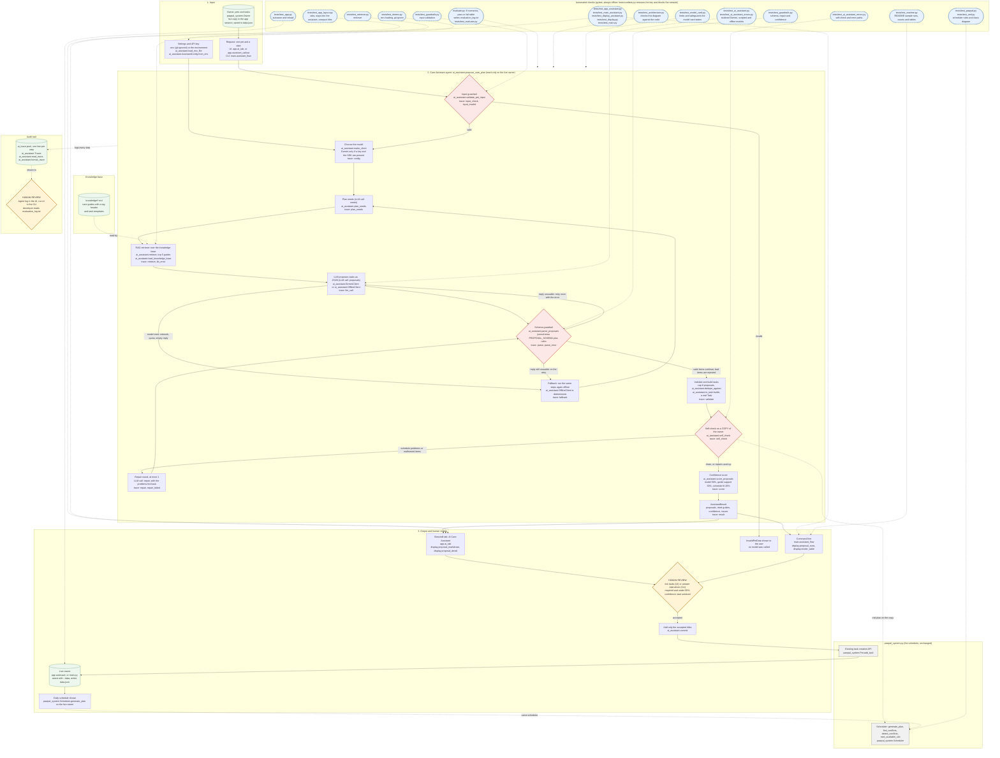
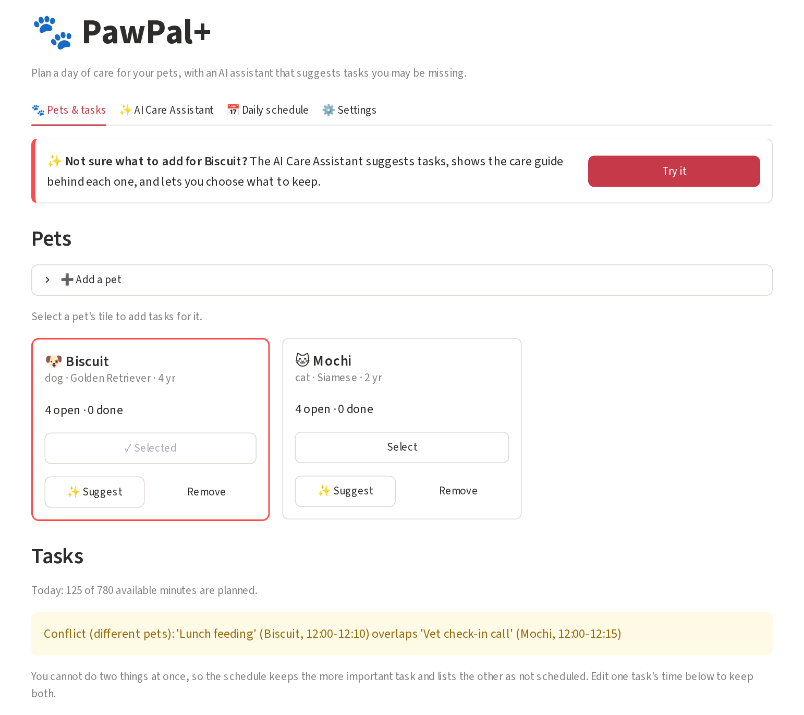
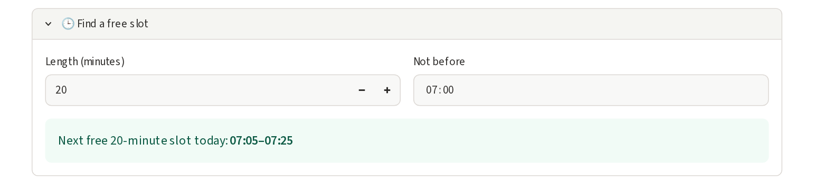
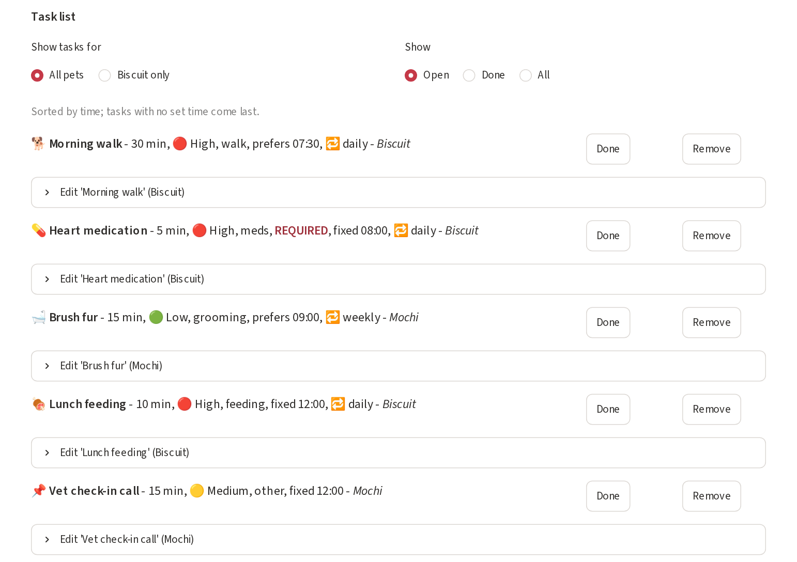
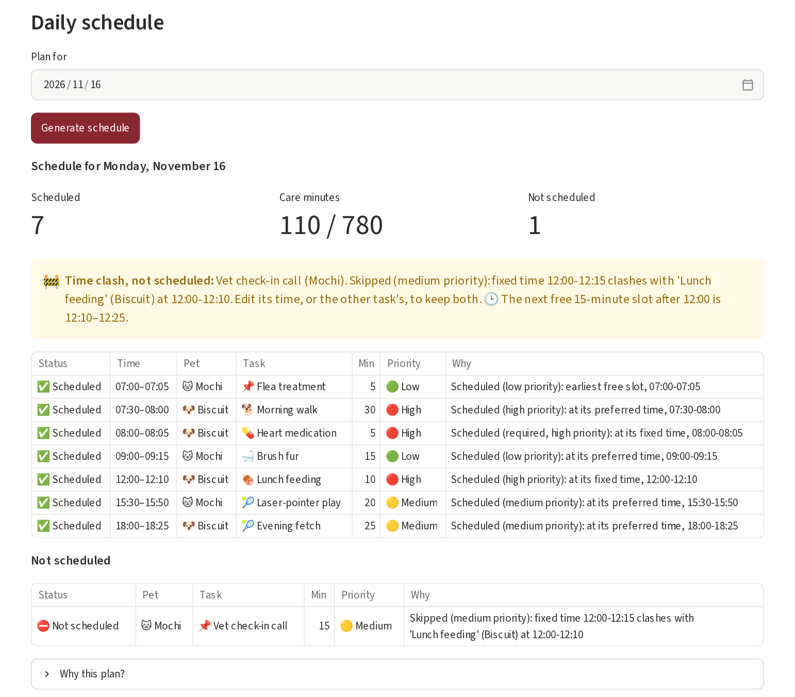

# 🐾 PawPal+ with the Care Assistant

## 1. The original project: PawPal+

PawPal+ is a Streamlit app (with a command-line demo) that helps a busy pet owner plan a day of care for one or more pets. Its original goals were to track care tasks (walks, feeding, medication, enrichment, grooming), to respect real constraints such as the owner's available time, task priority and preferred times, and to produce a daily schedule that explains why each task was placed or skipped. It was built as a small, fully tested domain model (`Owner`, `Pet`, `Task`, `Scheduler`) with conflict detection, recurring tasks and local saving, and its original documentation is kept in the [reference section](#reference-the-original-pawpal-documentation) at the end of this file.

## 2. The Care Assistant: grounded, validated AI task suggestions

The new AI system is the **Care Assistant**. Given a pet, it works out which care is missing, retrieves matching guides from a local knowledge base (RAG), and asks an LLM (Gemini, using a low-cost Flash-Lite model) to propose tasks as strict JSON. Each proposal is checked against a schema, must cite a guide it was grounded in, is dry-run through the existing scheduler on a *copy* of the owner, and gets a confidence score. The app and the command line then show the suggestions with their sources and confidence, and **nothing is added until a person accepts it**; accepted tasks go through the existing `Pet.add_task`.

It works with no key and no network: an offline mode runs the same pipeline with a deterministic stand-in for the model, and it is also the fallback if Gemini fails. Every step is written to a trace log, and the scheduler's own rules are unchanged.

## 3. Architecture overview

The diagram below is [diagrams/architecture.mmd](diagrams/architecture.mmd) (GitHub draws it; the file is the source of truth and this copy is synced from it).

<!-- BEGIN generated:architecture -->

<!-- END generated:architecture -->

**How to read it.** Solid arrows are the flow of data and control; dotted arrows mean "uses", "logs to" or "is checked by". Rounded dashed boxes are automated tests, diamonds are guardrails (red) and human review (amber), and cylinders are stores.

1. **Input.** The owner, pets and tasks (the live copy in the app session, saved to `data.json`), the settings and key from `.env` or the environment, and a request for one pet and a date from the Streamlit panel or the `main.py assist` command.
2. **Input guardrail.** `validate_pet_input` checks the pet before anything else: it must belong to the owner, with a sensible name, species, age (0 to 40) and length of free text, which is cleaned before use. A failure stops the run and is shown to the user; no model is called.
3. **Choose the model.** Gemini is used only if a key and the `google-genai` package are present; otherwise (or with `OFFLINE_MODE=1`) the deterministic offline client is used.
4. **Plan needs.** The first LLM call lists which kinds of care the pet's existing tasks do not cover (walks, feeding, play, grooming, medication). Offline, this is derived by rules from the species, age, special needs and missing task categories.
5. **RAG retriever.** The top 5 guides from `knowledge/*.md` are retrieved by tag and keyword scoring. The search terms are the model's, cleaned up and mapped onto the guides' tags, plus terms taken from the pet itself, so retrieval does not depend on how the model words things. Guides for another species are never returned.
6. **LLM proposes tasks** as JSON, citing the guides it used.
7. **Schema guardrail.** `parse_proposals` accepts only exactly the expected JSON (no prose, no code fences), validates every proposal against `PROPOSAL_SCHEMA` with `jsonschema`, and applies the rules a schema cannot state (a real `HH:MM` time when the timing needs one; every cited guide must be one that was retrieved). A bad individual proposal is rejected on its own. An unusable reply is retried once with the error fed back; if it is still unusable, or the model fails, the run falls back to the offline client.
8. **Validate and build tasks.** At most 8 proposals are kept, near-copies of existing tasks are dropped, and each survivor is built into a real `Task` through its normal constructor.
9. **Self-check.** The proposals are tried on a *copy* of the owner with the existing `Scheduler`, and the result is compared with the plan as it stands: tasks that would not be scheduled, existing tasks pushed out, new clashes, a day pushed over its limit. If there are problems, or malformed items, one **repair round** feeds them back to the model, and the corrected reply goes through the schema guardrail again.
10. **Confidence score.** Each proposal gets a score from 0 to 100%: the model's own figure (50%), whether a cited guide really covers that kind of task (30%) and how well the trial schedule placed it (20%).
11. **Output and human review.** The app (the `app.ai_tab` tab) and the CLI (`main.assistant_flow`) show each proposal with its confidence, the guides it cites, what the trial schedule did with it and any warnings, using the same formatting helpers from `display.py`. A person ticks (app) or types (CLI) what to add. Required tasks and any under 50% confidence start unticked.
12. **Commit.** Only the accepted titles are added, through the existing `Pet.add_task`; the app autosaves to `data.json` (the CLI saves only with `--data`). The daily schedule is then generated by the unchanged `Scheduler` on the live owner.
13. **Audit trail.** Every step is appended to `ai_trace.jsonl`, with the raw model replies, the retrieved guides and the validation results. The app shows it as "Agent log for this run", and the CLI prints the run id.

**Where things are checked.** Each part of the flow has automated tests (the dashed boxes name the files), `evaluate.py` runs the whole agent on eight scenarios, and `tests/test_architecture.py` checks the diagram itself against the code: every name in it must exist, every logged step must appear, the order must match real runs, the numbers must equal the code's, and nothing may reach the live owner except through human review. The scheduler (`pawpal_system.py`) is unchanged; its class diagram is [diagrams/uml_final.png](diagrams/uml_final.png).

## 4. Setup

Tested on Python 3.13 (the code uses 3.10+ syntax such as `X | None`, but no older version was tried). From the project folder:

```bash
python -m venv .venv
source .venv/bin/activate        # Windows: .venv\Scripts\activate
pip install -r requirements.txt
```

**Gemini key (optional).** Put it in the `.env` file in the project folder, which is git-ignored and never committed:

```bash
GEMINI_API_KEY=your-key-here
```

Without a key, or without the `google-genai` package, the assistant runs offline. Settings can also be real environment variables, which override `.env`:

| Variable | Meaning |
|---|---|
| `GEMINI_API_KEY` | Your Gemini API key. Blank or missing means offline mode. |
| `PAWPAL_GEMINI_MODEL` | The Gemini model; default `gemini-3.1-flash-lite`. |
| `OFFLINE_MODE=1` (or `PAWPAL_OFFLINE=1`) | Force offline mode even when a key is set: deterministic, canned-from-the-guides proposals, no network. |
| `PAWPAL_TRACE_FILE` | Where the step log goes; default `ai_trace.jsonl`. |

In online mode the pet's species, breed, age and special needs, its open task titles and the day window are sent to Google. The trace file stays local and records the raw model replies, never the key or the prompts.

**Run it**

```bash
python -m streamlit run app.py      # the app; the ✨ AI Care Assistant tab is the second tab
python main.py                      # the original command-line demo
python main.py assist               # Care Assistant on the command line: suggestions, then "Add which?"
python main.py assist --pet mochi --accept 1,3     # no question; also: all, none, or "" for the default ticks
python main.py assist --data data.json             # use your saved data; chosen tasks are saved back to it
python evaluate.py                  # run the 8 evaluation scenarios, print the table, write evaluation_log.txt
python -m pytest -q                 # the test suite (offline: no key or network needed)
```

New to the app? Press **Load sample data** for two pets and eight tasks (including a deliberate clash). Use `python -m streamlit` rather than a bare `streamlit` so the app runs with the packages of the active virtual environment; if it reports a missing package, or says the assistant is offline because `google-genai` is not installed, it was started with a different Python than the project's `.venv`.

## 5. Sample interactions

These are real runs. The blocks below are copied from the files in [evidence/](evidence/) by `scripts/sync_readme.py`, so they are exactly what the program printed. The two offline ones are deterministic, and `tests/test_readme.py` compares them with a fresh run.

### Sample 1: suggestions, a choice, and the new schedule (offline)

Biscuit the demo dog has walks, feeding, play and medication, but nothing for grooming. The assistant proposes two grooming tasks, grounded in the dog-grooming guide, both high confidence. The answer `1` is piped in at the "Add which?" prompt, so only "Brush coat" is added, and the daily schedule is regenerated with it.

<!-- BEGIN generated:sample-offline -->
```console
$ printf '1\n' | OFFLINE_MODE=1 python main.py assist --pet biscuit
✨ Care Assistant for 🐶 Biscuit - Sunday, November 15, 2026
Mode: offline (OFFLINE_MODE is set); suggestions come from the built-in care guides.
========================================================================
Needs:
  - Dog needs grooming and hygiene
Care guides used:
  - Grooming and hygiene for dogs [dog-grooming]
  - Daily exercise for dogs [dog-exercise]
  - Feeding routine for dogs [dog-feeding]

╭─────┬───────────────────┬───────┬────────────┬──────────┬───────────┬──────────────┬─────────────┬───────────────────────────────╮
│ #   │ Task              │   Min │ Priority   │ When     │ Repeats   │ Confidence   │ Fit         │ Sources                       │
├─────┼───────────────────┼───────┼────────────┼──────────┼───────────┼──────────────┼─────────────┼───────────────────────────────┤
│ 1   │ 🛁 Brush coat     │    10 │ 🟢 Low     │ any time │ 🔁 weekly │ 🟢 95%       │ ✅ at 07:10 │ Grooming and hygiene for dogs │
│     │                   │       │            │          │           │              │             │ [dog-grooming]                │
│ 2   │ 🛁 Tooth brushing │     5 │ 🟢 Low     │ any time │ 🔁 daily  │ 🟢 95%       │ ✅ at 07:00 │ Grooming and hygiene for dogs │
│     │                   │       │            │          │           │              │             │ [dog-grooming]                │
╰─────┴───────────────────┴───────┴────────────┴──────────┴───────────┴──────────────┴─────────────┴───────────────────────────────╯
(Confidence: 50% the model's own figure, 30% guide support, 20% schedule fit. Required tasks are marked ⭐.)
========================================================================
Add which? numbers like 1,3 | all | none | Enter = 1, 2: ✅ Added 1 task(s) to Biscuit: Brush coat

🐾 Today's Schedule - Sunday, November 15, 2026
Owner: Jordan | Pets: 🐶 Biscuit, 🐱 Mochi
Available: 07:00-20:00
========================================================================
╭──────────────┬─────────────┬────────────┬───────────────────────┬───────┬────────────┬─────────────────────────────────────────────╮
│ Status       │ Time        │ Pet        │ Task                  │   Min │ Priority   │ Why                                         │
├──────────────┼─────────────┼────────────┼───────────────────────┼───────┼────────────┼─────────────────────────────────────────────┤
│ ✅ Scheduled │ 07:00–07:05 │ 🐱 Mochi   │ 📌 Flea treatment     │     5 │ 🟢 Low     │ Scheduled (low priority): earliest free     │
│              │             │            │                       │       │            │ slot, 07:00-07:05                           │
│ ✅ Scheduled │ 07:05–07:15 │ 🐶 Biscuit │ 🛁 Brush coat         │    10 │ 🟢 Low     │ Scheduled (low priority): earliest free     │
│              │             │            │                       │       │            │ slot, 07:05-07:15                           │
│ ✅ Scheduled │ 07:30–08:00 │ 🐶 Biscuit │ 🐕 Morning walk       │    30 │ 🔴 High    │ Scheduled (high priority): at its preferred │
│              │             │            │                       │       │            │ time, 07:30-08:00                           │
│ ✅ Scheduled │ 08:00–08:05 │ 🐶 Biscuit │ 💊 Heart medication   │     5 │ 🔴 High    │ Scheduled (required, high priority): at its │
│              │             │            │                       │       │            │ fixed time, 08:00-08:05                     │
│ ✅ Scheduled │ 09:00–09:15 │ 🐱 Mochi   │ 🛁 Brush fur          │    15 │ 🟢 Low     │ Scheduled (low priority): at its preferred  │
│              │             │            │                       │       │            │ time, 09:00-09:15                           │
│ ✅ Scheduled │ 12:00–12:10 │ 🐶 Biscuit │ 🍖 Lunch feeding      │    10 │ 🔴 High    │ Scheduled (high priority): at its fixed     │
│              │             │            │                       │       │            │ time, 12:00-12:10                           │
│ ✅ Scheduled │ 15:30–15:50 │ 🐱 Mochi   │ 🎾 Laser-pointer play │    20 │ 🟡 Medium  │ Scheduled (medium priority): at its         │
│              │             │            │                       │       │            │ preferred time, 15:30-15:50                 │
│ ✅ Scheduled │ 18:00–18:25 │ 🐶 Biscuit │ 🎾 Evening fetch      │    25 │ 🟡 Medium  │ Scheduled (medium priority): at its         │
│              │             │            │                       │       │            │ preferred time, 18:00-18:25                 │
╰──────────────┴─────────────┴────────────┴───────────────────────┴───────┴────────────┴─────────────────────────────────────────────╯

Not scheduled:
╭──────────────────┬──────────┬──────────────────────┬───────┬────────────┬──────────────────────────────────────────╮
│ Status           │ Pet      │ Task                 │   Min │ Priority   │ Why                                      │
├──────────────────┼──────────┼──────────────────────┼───────┼────────────┼──────────────────────────────────────────┤
│ ⛔ Not scheduled │ 🐱 Mochi │ 📌 Vet check-in call │    15 │ 🟡 Medium  │ Skipped (medium priority): fixed time    │
│                  │          │                      │       │            │ 12:00-12:15 clashes with 'Lunch feeding' │
│                  │          │                      │       │            │ (Biscuit) at 12:00-12:10                 │
╰──────────────────┴──────────┴──────────────────────┴───────┴────────────┴──────────────────────────────────────────╯
🚧 Vet check-in call (Mochi): Skipped (medium priority): fixed time 12:00-12:15 clashes with 'Lunch feeding' (Biscuit) at 12:00-12:10
========================================================================
8 scheduled (120 min), 1 skipped
(Full step log of this run: ai_trace.jsonl, run id 92340c119ca9.)
```
<!-- END generated:sample-offline -->

### Sample 2: the same flow with Gemini

A live call for Mochi the demo cat, with `--accept none` so nothing is added. The needs and the proposals are Gemini's own; the guardrails are the same ones as in offline mode. Gemini's wording and picks vary from run to run, so a fresh run will not match the one pasted here exactly. Note that de-duplication only matches the same title, so a near-duplicate of a task the pet already has can still be suggested (a test shows this, and the model card describes a live case); the person reviewing has to notice.

<!-- BEGIN generated:sample-gemini -->
```console
$ python main.py assist --pet mochi --accept none
✨ Care Assistant for 🐱 Mochi - Sunday, November 15, 2026
Mode: Gemini (gemini-3.1-flash-lite); the pet's details and task titles were sent to Google.
========================================================================
Needs:
  - Establish a consistent daily feeding schedule
  - Monitor daily water intake
  - Provide dental hygiene care
  - Schedule regular litter box cleaning
  - Monitor weight and body condition
Care guides used:
  - Grooming and litter care for cats [cat-grooming]
  - Feeding routine for cats [cat-feeding]
  - Play and enrichment for cats [cat-play]

╭─────┬─────────────────────────────┬───────┬────────────┬───────────────┬───────────┬──────────────┬─────────────┬────────────────────────────────────╮
│ #   │ Task                        │   Min │ Priority   │ When          │ Repeats   │ Confidence   │ Fit         │ Sources                            │
├─────┼─────────────────────────────┼───────┼────────────┼───────────────┼───────────┼──────────────┼─────────────┼────────────────────────────────────┤
│ 1   │ 🍖 Morning feeding          │     5 │ 🔴 High    │ prefers 07:30 │ 🔁 daily  │ 🟢 100%      │ ✅ at 07:30 │ Feeding routine for cats [cat-     │
│     │                             │       │            │               │           │              │             │ feeding]                           │
│ 2   │ 🍖 Evening feeding          │     5 │ 🔴 High    │ prefers 18:00 │ 🔁 daily  │ 🟢 100%      │ ✅ at 18:00 │ Feeding routine for cats [cat-     │
│     │                             │       │            │               │           │              │             │ feeding]                           │
│ 3   │ 📌 Scoop litter box         │     5 │ 🟡 Medium  │ any time      │ 🔁 daily  │ 🟢 95%       │ ✅ at 07:35 │ Grooming and litter care for cats  │
│     │                             │       │            │               │           │              │             │ [cat-grooming]                     │
│ 4   │ 🎾 Interactive play session │    15 │ 🟡 Medium  │ prefers 19:00 │ 🔁 daily  │ 🟢 90%       │ ✅ at 19:00 │ Play and enrichment for cats [cat- │
│     │                             │       │            │               │           │              │             │ play]                              │
╰─────┴─────────────────────────────┴───────┴────────────┴───────────────┴───────────┴──────────────┴─────────────┴────────────────────────────────────╯
(Confidence: 50% the model's own figure, 30% guide support, 20% schedule fit. Required tasks are marked ⭐.)
========================================================================
Nothing added.
```
<!-- END generated:sample-gemini -->

### Sample 3: invalid pet data is refused before any model is called

A saved owner whose dog has age 99. `Pet` itself accepts any non-negative age, but the assistant's input guardrail allows 0 to 40, so it stops with a clear message instead of sending the data to a model.

<!-- BEGIN generated:sample-invalid -->
```console
$ OFFLINE_MODE=1 python main.py assist --data evidence/bad_pet_data.json --accept none
✨ Care Assistant was not asked: Rex's details need fixing:
  🚧 pet age must be a whole number from 0 to 40, got 99
```
<!-- END generated:sample-invalid -->

## 6. Design decisions and trade-offs

| Decision | Why | Trade-off |
|---|---|---|
| **The assistant proposes; a person decides.** Tasks are added only by `commit`, through the existing `Pet.add_task`, after the user ticks them. | The model can be wrong, and a pet's care plan should not change on its say-so. It also means no new write path into the data. | One extra step for the user. |
| **The scheduler is untouched; the self-check runs it on a copy of the owner.** | Reuses the rules that are already tested, and a trial can never change the real data. | Extra plan computations (cheap), and the check only reflects the chosen day. |
| **Offline and Gemini share one pipeline** behind a small `LLMClient` interface; offline is a deterministic stand-in that answers from the guides' own task templates. | Tests, the evaluation and the app all work with no key or network, and every guardrail is exercised without a model. | The offline "model" is canned, so its confidence scores say little about how Gemini does; model quality cannot be evaluated offline. |
| **One JSON schema is the single source of truth.** It is sent to Gemini and enforced locally with `jsonschema`, plus a stricter local copy and a few rules a schema cannot state. | The shape of a proposal is defined once. Gemini accepts only a subset of JSON Schema, so the stricter checks stay local. | Replies wrapped in prose or code fences are rejected, not leniently extracted; the cost is one retry, then the fallback. |
| **Retrieval is deterministic keyword and tag scoring**, not embeddings, and always adds terms derived from the pet. | No extra service or dependency, repeatable results, and easy to test. A live Gemini run showed why the pet-derived terms matter: it wrote its search terms as phrases ("cat dental care"), nothing matched, and all five proposals were rejected as ungrounded. Terms are now split into words and mapped to the guides' tags, and the pet's own facts are always searched. | It misses synonyms outside a small built-in map, and the knowledge base is ten short hand-written guides, so unusual species get little. |
| **Grounding is required:** a proposal must cite a guide that was actually retrieved, or it is rejected. | Stops invented sources, and gives the user something to check each suggestion against. | If retrieval is poor, good proposals are thrown away (exactly what that live run showed before the fix). |
| **Confidence is a blend:** model's figure 50%, guide support 30%, schedule fit 20%. | Models are poorly calibrated, so the model's own number alone is not trusted; the other two parts are checked by code. | The weights are judgment calls, not fitted to data. |
| **At most one repair round,** and anything still wrong is shown to the user. | Bounds cost and latency, and problems stay visible instead of being quietly dropped. | A second round might fix more. |
| **Any Gemini failure falls back to offline,** and the result says so (a banner in the app and CLI, `fallback` in the log). | The user always gets an answer, and the failure is never hidden. | Fallback suggestions come from the built-in guides and may differ from what Gemini would have said. |
| **The log keeps raw replies but hashes prompts.** One JSON line per step, local and git-ignored, with the key scrubbed. | Enough to audit and debug a run without copying the pet's data around. | Replies (which are proposals) are stored on disk. |
| **A low-cost model at temperature 0** (`gemini-3.1-flash-lite`). | The task is short, structured and grounded, and the schema and checks catch mistakes. | Less reasoning than a larger model; the model can be changed with `PAWPAL_GEMINI_MODEL`. |
| **A small `.env` loader** for the few names this project uses, instead of the `python-dotenv` package. | No new dependency, and it can only set the project's own settings (a real environment variable always wins). | It understands only simple `NAME=value` lines. |

## 7. Testing summary

<!-- BEGIN generated:tests-per-file -->
**652 tests, all passing offline.** The original 314 tests are unchanged and still pass; the rest are for the Care Assistant. Run them with `python -m pytest -q`.

| Test file | Tests | What it checks |
|---|---:|---|
| `tests/test_app.py` | 50 | the Streamlit app, driven headlessly (the original suite) |
| `tests/test_display.py` | 37 | emoji, badges and table formatting (the original suite) |
| `tests/test_main.py` | 4 | the command-line demo (the original suite) |
| `tests/test_pawpal.py` | 208 | scheduler rules, model validation, saving and loading (the original suite) |
| `tests/test_uml.py` | 15 | the class diagram against pawpal_system.py (the original suite) |
| `tests/test_ai_assistant.py` | 56 | assistant core: config, knowledge base, strict JSON parsing, offline client, self-check, agent loop, commit |
| `tests/test_ai_assistant_errors.py` | 33 | error paths: bad SDK or reply, broken knowledge base, retrieval that ignores the model's wording |
| `tests/test_app_assistant.py` | 10 | the Care Assistant tab in the app: suggest, review, add |
| `tests/test_app_layout.py` | 16 | the app's tabs, the ways into the assistant, the pet chooser, collapsing forms, the narrow page |
| `tests/test_architecture.py` | 14 | diagrams/architecture.mmd against the code |
| `tests/test_display_assistant.py` | 15 | formatting of proposals shared by the app and the CLI |
| `tests/test_dotenv.py` | 16 | .env loading and keeping it out of git |
| `tests/test_evaluate.py` | 18 | evaluate.py: scenarios, schema measurement, summary and log |
| `tests/test_guardrails.py` | 47 | schema validation and repair, input validation, confidence scores, offline switch, step log |
| `tests/test_main_assistant.py` | 37 | the Care Assistant on the command line |
| `tests/test_model_card.py` | 27 | model_card.md: its tables, numbers and every limitation it states, against the code and evidence |
| `tests/test_readme.py` | 23 | this README against the files and runs it quotes |
| `tests/test_retriever.py` | 26 | the retriever: scoring, top-k, species and life-stage filters, pet and query search |
| **Total** | **652** | |
<!-- END generated:tests-per-file -->

- **Offline and keyless.** `tests/conftest.py` forces offline mode, removes any `GEMINI_API_KEY` and never reads the real `.env`. As an independent check, `scripts/block_network.py` refuses and counts every outbound connection: the full suite passes with a fake key set and **0 network attempts**.
- **Coverage.** `ai_assistant.py` has 100% line coverage (669 of 669 statements), measured with coverage.py (a one-off measurement, not a project dependency).
- **Tests that bite.** The assistant, the diagram and the retrieval fix were each checked by temporarily breaking the code (no species filter, schema checks off, pushed-out tasks unreported, a path around human review, a wrong number in the diagram, and so on) and confirming a test fails. Those were one-off experiments in a scratch copy, not part of the suite.
- **Documents checked against the code.** `tests/test_uml.py` checks the class diagram, `tests/test_architecture.py` the architecture diagram, and `tests/test_readme.py` this file's sections, its diagram, its test counts, its results table and its offline sample runs.

### evaluate.py results

`python evaluate.py` runs the whole assistant on eight predefined scenarios and applies the same general checks to each, plus checks of its own. The full text log, with every scenario's checks, proposals and step log, is [evaluation_log.txt](evaluation_log.txt).

<!-- BEGIN generated:evaluate-table -->
```text
╭─────┬───────────────────────────────────────────┬──────────┬─────────┬────────────┬──────────┬──────────────┬──────────┬─────────╮
│ #   │ Scenario                                  │ Result   │ Props   │ Rejected   │ Schema   │ Confidence   │ Checks   │ Notes   │
├─────┼───────────────────────────────────────────┼──────────┼─────────┼────────────┼──────────┼──────────────┼──────────┼─────────┤
│ 1   │ Healthy adult dog, no tasks               │ ✅ PASS  │ 7       │ 0          │ ✅ 2/2   │ 95% / 95%    │ 9/9      │         │
│ 2   │ Cat with a partial routine                │ ✅ PASS  │ 2       │ 0          │ ✅ 2/2   │ 95% / 95%    │ 9/9      │         │
│ 3   │ Senior dog on medication                  │ ✅ PASS  │ 8       │ 1          │ ✅ 2/2   │ 87% / 93%    │ 9/9      │         │
│ 4   │ Bare-minimum pet (edge: nothing to go on) │ ✅ PASS  │ 0       │ 0          │ ✅ 2/2   │ -            │ 9/9      │         │
│ 5   │ Over-capacity day (edge)                  │ ✅ PASS  │ 2       │ 0          │ ✅ 3/3   │ 95% / 95%    │ 10/10    │         │
│ 6   │ Impossible required task (edge)           │ ✅ PASS  │ 1       │ 0          │ ✅ 3/3   │ 95% / 95%    │ 10/10    │         │
│ 7   │ Model answers badly twice                 │ ✅ PASS  │ 7       │ 0          │ ✅ 3/5   │ 95% / 95%    │ 10/10    │         │
│ 8   │ Invalid pet data (guardrail)              │ ✅ PASS  │ -       │ -          │ -        │ -            │ 3/3      │         │
╰─────┴───────────────────────────────────────────┴──────────┴─────────┴────────────┴──────────┴──────────────┴──────────┴─────────╯
Schema: ✅/❌ for the last model reply, then valid/total replies (needs, proposals and repairs). Confidence: lowest / average of the accepted proposals.
8/8 scenarios passed
```
<!-- END generated:evaluate-table -->

- **Scenarios.** A healthy dog with no tasks; a cat with a partial routine; a senior dog on medication; and five more that probe the edges: a **bare-minimum pet** of a species with no guide (nothing to go on), a day limited to 20 minutes (**over capacity**), a required task proposed at 23:30 after the day ends (**impossible**), a model that answers badly twice, and a pet with invalid data.
- **General checks (every scenario).** The last model reply matches the JSON schema; every proposal cites a retrieved guide; no other species' guide is cited; confidence is between 0 and 100%; no schedule error is left unresolved; the live owner is unchanged.
- **Reading the table.** *Schema* shows whether the last model reply passed schema validation, then how many of all the replies in the run did; `✅ 3/5` in scenario 7 means the two bad replies were correctly counted invalid and the fallback's three were valid. *Confidence* is the lowest and average of the accepted proposals. Scenario 4 passes with no proposals: nothing it could ground was better than something invented.
- **What this does and does not show.** The default run is offline, so it tests the pipeline and its guardrails deterministically. The offline model returns the guides' own task templates, so the high confidence scores there say little about Gemini. `python evaluate.py --online` uses Gemini for the scenarios that do not script their model (results can vary run to run), and scenarios 6 and 7 always use a scripted model because they need one particular behaviour.

## 8. Reproducible execution evidence

Everything above can be regenerated. One command re-runs the commands this README cites, saves each real output (with the command, time, Python version and git commit at the top) to [evidence/](evidence/), and then refreshes the generated blocks in this file from them (`scripts/sync_readme.py`):

```bash
bash scripts/make_evidence.sh      # re-runs the commands, saves the outputs, and refreshes this README's generated blocks
```

The key is never printed (the evidence files were checked for it). The Gemini transcript is recorded only when a key is configured, and the two live experiments in the last rows are run by their own scripts, because they make real calls.

| File | Command | What it shows |
|---|---|---|
| [evidence/pytest_full.txt](evidence/pytest_full.txt) | `python -m pytest -q` | The full suite |
| [evidence/pytest_original_314.txt](evidence/pytest_original_314.txt) | the five original test files | The original 314 tests unchanged |
| [evidence/pytest_no_network.txt](evidence/pytest_no_network.txt) | `PYTHONPATH=scripts python -m pytest -p block_network -q` with a fake key | 0 network attempts |
| [evidence/pytest_per_file.txt](evidence/pytest_per_file.txt) | `pytest --collect-only -q` | Tests per file |
| [evidence/evaluate_run.txt](evidence/evaluate_run.txt) and [evaluation_log.txt](evaluation_log.txt) | `python evaluate.py` | The results table and the full log |
| [evidence/cli_assist_offline.txt](evidence/cli_assist_offline.txt) | sample 1 | Offline suggestions, a choice, the new schedule |
| [evidence/cli_assist_gemini.txt](evidence/cli_assist_gemini.txt) | sample 2 | A live Gemini run |
| [evidence/cli_assist_invalid_pet.txt](evidence/cli_assist_invalid_pet.txt) | sample 3 | The input guardrail |
| [evidence/environment.txt](evidence/environment.txt) | | Python and package versions |
| [evidence/rag_comparison.txt](evidence/rag_comparison.txt) | `python scripts/rag_comparison.py` (live Gemini, about 30 calls) | No retrieval vs first RAG design vs current RAG, on four pets; used by the [model card](model_card.md) |
| [evidence/injection_probe.txt](evidence/injection_probe.txt) | `python scripts/probe_injection.py` (live Gemini) | Three working prompt-injection probes and one stopped by the input check; used by the [model card](model_card.md) |

The outputs, pasted from those files:

**Environment**

<!-- BEGIN generated:evidence-environment -->
```text
$ environment
# 2026-11-15 23:56:42 UTC | Python 3.13.15 | commit eb564b1

Linux 7.0.14-linuxkit aarch64
google-genai              3.3.0
jsonschema                4.26.0
pytest                    9.2.0
streamlit                 1.67.0
tabulate                  0.10.0
wcwidth                   0.9.4
```
<!-- END generated:evidence-environment -->

**The full test suite**

<!-- BEGIN generated:evidence-pytest-full -->
```text
$ .venv/bin/python -m pytest -q
# 2026-11-15 23:56:06 UTC | Python 3.13.15 | commit eb564b1

........................................................................ [ 11%]
........................................................................ [ 22%]
........................................................................ [ 33%]
........................................................................ [ 45%]
........................................................................ [ 56%]
........................................................................ [ 67%]
........................................................................ [ 79%]
........................................................................ [ 90%]
............................................................             [100%]
636 passed in 11.07s

[exit status 0]
```
<!-- END generated:evidence-pytest-full -->

**The original 314 tests, run on their own**

<!-- BEGIN generated:evidence-pytest-original -->
```text
$ .venv/bin/python -m pytest tests/test_pawpal.py tests/test_app.py tests/test_display.py tests/test_main.py tests/test_uml.py -q
# 2026-11-15 23:56:17 UTC | Python 3.13.15 | commit eb564b1

........................................................................ [ 22%]
........................................................................ [ 45%]
........................................................................ [ 68%]
........................................................................ [ 91%]
..........................                                               [100%]
314 passed in 7.64s

[exit status 0]
```
<!-- END generated:evidence-pytest-original -->

**The full suite with a fake API key set and every outbound connection blocked and counted**

<!-- BEGIN generated:evidence-pytest-no-network -->
```text
$ GEMINI_API_KEY=fake-key-not-real PYTHONPATH=scripts .venv/bin/python -m pytest -p block_network -q
# 2026-11-15 23:56:25 UTC | Python 3.13.15 | commit eb564b1

........................................................................ [ 11%]
........................................................................ [ 22%]
........................................................................ [ 33%]
........................................................................ [ 45%]
........................................................................ [ 56%]
........................................................................ [ 67%]
........................................................................ [ 79%]
........................................................................ [ 90%]
............................................................             [100%]
NETWORK ATTEMPTS (non-loopback connect or DNS lookup): 0 []
636 passed in 11.30s

[exit status 0]
```
<!-- END generated:evidence-pytest-no-network -->

**Tests per file**

<!-- BEGIN generated:evidence-pytest-per-file -->
```text
$ .venv/bin/python -m pytest --collect-only -q | cut -d: -f1 | grep '^tests/' | sort | uniq -c
# 2026-11-15 23:56:37 UTC | Python 3.13.15 | commit eb564b1

     56 tests/test_ai_assistant.py
     33 tests/test_ai_assistant_errors.py
     50 tests/test_app.py
     10 tests/test_app_assistant.py
     14 tests/test_architecture.py
     37 tests/test_display.py
     15 tests/test_display_assistant.py
     16 tests/test_dotenv.py
     18 tests/test_evaluate.py
     47 tests/test_guardrails.py
      4 tests/test_main.py
     37 tests/test_main_assistant.py
     27 tests/test_model_card.py
    208 tests/test_pawpal.py
     23 tests/test_readme.py
     26 tests/test_retriever.py
     15 tests/test_uml.py

[exit status 0]
```
<!-- END generated:evidence-pytest-per-file -->

The `evaluate.py` table is in section 7, and the three sample transcripts are in section 5.

---

# Reference: the original PawPal+ documentation

The sections below are the original PawPal+ documentation: the scheduling features, the data model, persistence, the demo and the original test suite. They are kept as they were, except where noted.

## ✨ Features

- **Pets as tiles, tasks per pet.** Add several pets (shown as selectable tiles with open and done counts) and give each tasks with a duration, priority, category, optional notes, whether it is **required** (such as medication), and how often it repeats.
- **A daily plan with reasons.** `Scheduler.generate_plan` turns every pet's tasks into one clock-time schedule and records a reason for each task, scheduled or skipped ("Why this plan?").
- **Sorting by time.** `Scheduler.sort_by_time` lists tasks by the time they ask for, earliest first, with tasks that have no time last; ties go to the higher priority, then the title (ignoring case).
- **Filtering.** `Scheduler.filter_tasks` narrows the list by pet and by completion status (open, done or all).
- **Conflict warnings.** `Scheduler.find_conflicts` warns, as soon as you add a task, when two fixed-time tasks due today overlap, for the same pet or different pets, and says what will happen. When the plan is built, the clash is resolved: the more important task is kept and the other is skipped with a reason.
- **Next free slot.** `Scheduler.next_available_slot` finds the earliest free gap of a given length in the day's plan, optionally not before a given time. The app offers it in a "Find a free slot" panel and uses it to suggest where a task that lost a clash could go.
- **Recurring tasks.** Completing a daily or weekly task creates the next occurrence automatically (`Task.mark_complete`, `Task.next_due_date`), calculated with `timedelta`; a weekly task stays on its weekday even if you finish it late.
- **Flexible, preferred or fixed times.** A task can take the earliest free slot, try a preferred time first, or insist on a fixed time. (In code an owner can also set a default preferred time per category, `Owner.preferred_times`; the app does not expose that yet.)
- **A daily limit.** Set the day's start and end and an optional cap on care minutes; the app warns when today's tasks exceed it, and the plan skips the lowest-priority tasks that do not fit.
- **Required tasks are protected.** A required task that cannot be scheduled is never squeezed in by bumping others; it is flagged in red so you can act.
- **One owner, no double-booking.** Tasks for different pets never overlap, because one person cannot do two things at once.
- **Remembers your data.** Pets and tasks are saved to `data.json` automatically (`Owner.save_to_json`) and loaded the next time (`Owner.load_from_json`). A damaged file is set aside, never overwritten. See [Data persistence](#-data-persistence).
- **Easy to read.** An emoji for each kind of pet and task (🐶 🐱, 💊 🐕 🍖 🎾 🛁), color-coded priority (🔴 🟡 🟢) and status (✅ scheduled, ⛔ not scheduled, 🚨 required task left out), a red REQUIRED tag, green / blue / red task status (done / starts later / overdue), and aligned tables in both the app and the terminal.
- **Safe input.** Blank names, non-positive durations, impossible day windows and duplicate pets are rejected with a clear message.
- **Tested.** 314 automated tests cover the backend, the app, the formatting, the demo and the class diagram (the Care Assistant's own tests are described in the testing summary above).

## 🏆 Extra-credit challenges

| Challenge | What was built | Where |
|---|---|---|
| **1. Advanced algorithm** | `Scheduler.next_available_slot`: the earliest free gap that fits, respecting the day window, the daily limit and a "not before" time | [Smarter Scheduling](#-smarter-scheduling); the "Find a free slot" panel and clash suggestions in `app.py`; `main.py` step 5 |
| **2. Data persistence** | `Owner.save_to_json` / `Owner.load_from_json` (with `to_dict` / `from_dict` on `Task`, `Pet` and `Owner`), autosave and safe loading in the app | [Data persistence](#-data-persistence) |
| **3. Professional output** | `display.py`: emoji for task types and pets, color-coded priority and status, `tabulate` tables in the terminal, aligned and tested | [Features](#-features); the screenshots below; `main.py` output |

The agent workflow for these (files changed, what was asked, what was done, corrections) is in the "Agent Workflow" section of [ai_interactions.md](ai_interactions.md).

## 🧩 Implementation Summary

**What was built.** The backend is in [pawpal_system.py](pawpal_system.py): a small domain model plus a `Scheduler` that turns it into a one-day plan with a reason for every decision. [main.py](main.py) is a command-line demo, [app.py](app.py) is the Streamlit UI, connected to those classes. The pytest suite (314 tests) is in [tests/](tests/): the backend ([test_pawpal.py](tests/test_pawpal.py)), the real app run headlessly ([test_app.py](tests/test_app.py)), the display formatting ([test_display.py](tests/test_display.py)), the command-line demo ([test_main.py](tests/test_main.py)) and the diagram ([test_uml.py](tests/test_uml.py)). [display.py](display.py) turns results into emoji, color-coded badges and tables for both the app and the terminal. The final class diagram is [diagrams/uml_final.mmd](diagrams/uml_final.mmd) (Mermaid source; `tests/test_uml.py` checks it against the code). The picture below is a rendering of it.


**How the classes work together**

- An `Owner` has many `Pet`s, and a `Pet` has many `Task`s. The owner also holds the day window (and an optional daily minutes cap) that a plan must fit inside.
- `Owner.get_all_tasks()` returns every pet's tasks together as `PetTask(pet, task)` pairs. The `Scheduler` reads tasks only through this method, so it always plans across all pets, never one.
- `Scheduler.generate_plan(date)` runs a pipeline: keep the tasks due that day (`Task.is_due`: it has started and is not completed), sort them (required first, then priority, then shorter), fit them onto the clock, and return a `DailyPlan`.
- A `DailyPlan` holds the `ScheduledItem`s (a task at a start and end time, with the reason), the `SkippedTask`s (a task and why it was dropped, `flagged` when a required task could not fit) and a list of warnings. It can print itself as text (`explain()`) or as table rows (`to_table()`).

**Scheduling rules.** There is one owner, so tasks never overlap, even across pets. Fixed-time tasks are placed first; other tasks go at their preferred time if it is free, otherwise in the earliest gap that fits. A task that does not fit is skipped with a reason, and later tasks are still tried. A required task that does not fit is flagged for the owner; it is never forced in by bumping other tasks.

**How the UI connects to the classes** ([app.py](app.py)). `app.py` holds no planning logic; it only collects input, calls the classes above, and displays the result.

- **Memory:** Streamlit re-runs the script on every click, so the `Owner` is kept in `st.session_state`. The app checks `"owner" not in st.session_state` and creates the `Owner` only the first time (loading it from `data.json` if that file exists); after that it reuses the stored object. Every run ends by saving to `data.json` if anything changed (see [Data persistence](#-data-persistence)).
- **Forms call methods:** "Add pet" calls `Owner.add_pet(Pet(...))`; "Add task" calls `Pet.add_task(Task(...))`; "Save changes" calls `Pet.edit_task`; "Save availability" calls `Owner.set_availability`. The classes validate the input, and the UI shows any `ValueError` as an error message.
- **Buttons call methods:** "Done" calls `Scheduler.mark_task_complete` (which creates the next occurrence of a daily or weekly task), and "Remove" calls `Pet.remove_task` or `Owner.remove_pet`, as button callbacks that run before the page redraws.
- **Pets as tiles:** each pet is a bordered tile (icon, name, species, breed and age, open and done task counts, and Select / Remove buttons), laid out three to a row. Selecting a tile chooses which pet new tasks are added to, and a newly added pet is selected automatically. There is no pet dropdown anywhere: the task form follows the selected tile, and the task list has a "Show tasks for" choice between all pets and the selected one.
- **Task list:** it is built with `Scheduler.filter_tasks` (by pet and by Open / Done / All) and ordered with `Scheduler.sort_by_time`. Overlapping fixed-time tasks show a warning from `Scheduler.find_conflicts` as soon as they are added.
- **The daily limit:** "Max care minutes per day" (0 = no limit) caps what the plan schedules each day. Adding tasks is never blocked; instead, the Tasks section warns as soon as today's tasks add up to more than the available time (`Owner.capacity_minutes()`), and the plan then skips the lowest-priority tasks that do not fit, with a reason, and flags any required task it cannot place.
- **Free slots:** a "Find a free slot" panel calls `Scheduler.next_available_slot`, and a clash message in the schedule suggests where the task that lost out could go instead.
- **Formatting:** `display.py` supplies the emoji, color-coded priority and status badges and the table rows the app shows (the same module formats the terminal tables in `main.py`).
- **Updating the display:** after a successful change the app saves a message and calls `st.rerun()`, so every list shows the new state. "Generate schedule" calls `Scheduler.generate_plan`, and the plan is rebuilt from the live `Owner` on every run, so it never goes stale; it appears as totals, problems (red for a required task left out, amber for a clash, blue for tasks that did not fit), a chronological schedule table, a separate "Not scheduled" table and a "Why this plan?" explanation.

## 📐 Smarter Scheduling

Phase 4 added four features on top of the basic planner, and a fifth (the next free slot) was added as an extra-credit challenge. Each is implemented by a named method, and `python main.py` demonstrates all of them.

| Feature | Method(s) | What it does |
|---------|-----------|--------------|
| Sorting by time | `Scheduler.sort_by_time()` (uses `Task.requested_time`) | Orders tasks by the time they ask for, earliest first; tasks with no time go last |
| Filtering | `Scheduler.filter_tasks()` | Keeps tasks for one pet and/or with one completion status |
| Conflict detection | `Scheduler.find_conflicts()`; `Scheduler.detect_conflicts()`; clash handling in `Scheduler.fit_to_available_time()` | Warns about overlapping fixed-time tasks, and resolves clashes when planning |
| Recurring tasks | `Task.mark_complete()`, `Task.next_due_date()`, `Pet.complete_task()`, `Scheduler.mark_task_complete()` | Completing a daily or weekly task creates the next occurrence |
| Next free slot (extra credit) | `Scheduler.next_available_slot()` | Finds the earliest free gap of a given length in the day's plan |

(The planner itself orders tasks by importance, not by time, with `Scheduler.sort_tasks()`: required first, then priority, then shorter.)

**Sorting.** `sort_by_time` uses `sorted()` with a lambda key that returns a tuple: the requested time (`fixed_time`, else `preferred_start`), with `time.max` standing in for "no time" so those tasks sort last without comparing a time to `None`; then higher priority; then title. Times are stored as `datetime.time` values, which compare correctly as they are. Zero-padded `"HH:MM"` strings would also sort correctly, but a string such as `"9:30"` would not, so strings were not used. It returns a new list and leaves its input unchanged.

**Filtering.** `filter_tasks(tasks=None, *, pet_name=None, completed=None)` keeps tasks for a pet (matched ignoring case) and/or by completion status (`True` for finished, `False` for open, `None` for any). Filters combine, an unknown pet gives an empty list, and with no list given it starts from every pet's tasks via `Owner.get_all_tasks()`.

**Conflict detection.** `find_conflicts(on)` returns a list of plain warning messages and never raises or changes anything. It checks every pair of due tasks that have a fixed time, for the same pet or different pets, and uses duration, so two tasks conflict when their time ranges overlap, not only when they start in the same minute (back-to-back tasks do not conflict). When a plan is built, `fit_to_available_time()` resolves the same clashes: it keeps the task that sorts first (required, then priority) and skips the other with a reason and a plan warning. `detect_conflicts()` checks a finished plan, where it should always find none. Both checks share one efficient search, `_overlapping_pairs()`: the spans are sorted by start time once, and each span is compared only with the later ones that start before it ends, stopping at the first that does not. The cost is about the sort plus the number of overlaps found, so a conflict-free day is checked in a single pass (measured at roughly 475 times faster than comparing every pair for 1000 tasks).

**Recurring tasks.** `Task.mark_complete(on)` marks the task done and, for a daily or weekly task, returns a new copy (new id, same details) that is due on `Task.next_due_date(on)`; `Pet.complete_task()` adds it to the pet, and `Scheduler.mark_task_complete(task_id, on)` finds the right pet first. The date is calculated with `timedelta`: a daily task is next due the day after (`on + timedelta(days=1)`), a weekly one a week later. Dates stay on the task's own schedule, so a weekly Monday task finished late on Wednesday is next due the following Monday, not a week from Wednesday. A one-off task, or one already completed, creates nothing, so completing twice never makes a duplicate. Each series has one open occurrence at a time, and finished ones stay in the list as history (filter by status to see them).

**Tradeoffs.** Conflict detection only looks at fixed-time tasks, because flexible tasks have no committed slot and the planner moves them to avoid overlaps. Because the next occurrence is created only when a task is completed, the plan cannot preview future occurrences of a recurring task beyond the next one.

**Next free slot (extra credit).** `next_available_slot(on, minutes, not_before=None)` answers "when could a new task of this length go?". It builds the plan for that day, subtracts every scheduled task from the day window to get the free gaps, and returns the first gap, in time order, that is long enough, as `(start, end)`, or `None` if there is none. So the answer is the *earliest* slot, and a new task placed there cannot clash with or move anything already planned. `not_before` skips earlier gaps (a slot may start part-way into a gap), which is how a task that wanted 12:00 gets "the next free slot after 12:00". The daily limit counts: if `minutes` more would go over `available_minutes`, there is no slot, even if the day has room. A slot may end exactly when the day ends. The app uses it in the "Find a free slot" panel and in clash messages ("The next free 15-minute slot after 12:00 is 12:10–12:25"), and `main.py` step 5 shows it. Its tests compare it with a brute-force minute-by-minute scan on 40 random days, and check that a task fixed at the returned slot is scheduled exactly there with nothing else moving.

## 💾 Data Persistence

PawPal+ remembers your pets and tasks between runs by saving them to a `data.json` file.

### How it works

1. **First run.** If there is no `data.json`, the app starts empty. Nothing is written until you change something.
2. **Every change is saved.** At the end of every run of the app, it compares the owner's data with what it last saved and, if anything changed, calls `Owner.save_to_json("data.json")`. That covers every kind of change: adding, editing, completing and removing pets and tasks, changing the day's hours, loading the sample data, and clearing everything.
3. **Next run.** When a new browser session starts, the app calls `Owner.load_from_json("data.json")` and shows "Loaded 2 pet(s) and 8 task(s) from data.json". Opening the app does not rewrite the file.
4. **A damaged file is never destroyed.** If `data.json` cannot be read (invalid JSON, the wrong version, a missing field, or a value the classes reject), the app moves it to `data.json.damaged`, shows an error that says why, and starts empty, so the next save cannot overwrite your only copy. If the location cannot be written (for example a read-only disk), the app shows a warning and keeps working in memory.
5. **Starting over.** The *Saved data* section of the Settings tab has a **Clear all data** button, enabled only after you tick a confirmation box; it empties the app and the file.

### How complex objects become JSON

I used a hand-written dictionary conversion instead of a library such as marshmallow. A pet owns tasks and the owner owns pets, but the structure is small and the classes already validate themselves, so the simplest correct design was:

- `to_dict()` on `Task`, `Pet` and `Owner` produces plain JSON-safe data: enums by name (`"HIGH"`, `"WALK"`, `"DAILY"`), times and dates as ISO text (`"08:00:00"`, `"2026-10-18"`), ids kept, and tasks nested inside their pet.
- `from_dict()` rebuilds objects **through their constructors**, so every rule runs again on load (a task needs a title and a positive duration, a pet needs a name, the day must end after it starts, ids must be unique). A hand-edited file that breaks a rule is rejected with a `ValueError` naming the pet and task, never half-loaded. Optional fields have defaults, so a minimal hand-written file loads.
- `save_to_json(path)` writes a temporary file and then moves it over `data.json`, so a crash or a full disk during the write cannot leave a half-written file. `load_from_json(path)` raises `FileNotFoundError` for a missing file and `ValueError` for anything wrong inside it.
- The file has a `"version": 1` field so a future change to the layout can be told apart from a damaged file.

```json
{
  "version": 1,
  "owner": {
    "name": "Jordan",
    "day_start": "07:00:00",
    "day_end": "20:00:00",
    "available_minutes": null,
    "preferred_times": {},
    "pets": [{"id": "…", "name": "Biscuit", "species": "dog", "tasks": [{"title": "Morning walk", "priority": "HIGH", "…": "…"}]}]
  }
}
```

### Where the file lives, and which files changed

`data.json` is created next to `app.py`. To use another location, set the `PAWPAL_DATA_FILE` environment variable (the tests do this so they never touch your data). `data.json` is listed in `.gitignore` because it is your own data, not part of the project.

| File | Change |
|---|---|
| [pawpal_system.py](pawpal_system.py) | `to_dict` / `from_dict` on `Task`, `Pet` and `Owner`; `Owner.save_to_json` and `Owner.load_from_json`; `DATA_VERSION` and small helpers |
| [app.py](app.py) | `data_file`, `load_saved_owner`, `get_owner` (loads on first use), `autosave` (end of every run), `clear_all`, and the *Saved data* section of the Settings tab |
| [main.py](main.py) | Step 8 saves to a temporary folder and loads it back, printing that the result is identical |
| [tests/test_pawpal.py](tests/test_pawpal.py), [tests/test_app.py](tests/test_app.py) | Round trips, every kind of damaged file, safe writes; autosave, a new session loading, damaged-file handling, clear-all; the UI tests now use a temporary data file |
| [tests/test_uml.py](tests/test_uml.py), [diagrams/uml_final.mmd](diagrams/uml_final.mmd) | The diagram shows the new methods, and the test checks it |
| [.gitignore](.gitignore) | Ignores `data.json`, `data.json.tmp` and `data.json.damaged` |

## 🖥️ Sample Output

The daily plan printed by `python main.py` (the full output, including sorting, filtering, conflict warnings, free slots, recurring tasks and saving, is in the [Demo Walkthrough](#-demo-walkthrough) below). The dates in the output are the day the script is run, so they change daily.

```
🐾 Today's Schedule - Sunday, October 18, 2026
Owner: Jordan | Pets: 🐶 Biscuit, 🐱 Mochi
Available: 07:00-20:00
========================================================================
╭──────────────┬─────────────┬────────────┬───────────────────────┬───────┬────────────┬─────────────────────────────────────────────╮
│ Status       │ Time        │ Pet        │ Task                  │   Min │ Priority   │ Why                                         │
├──────────────┼─────────────┼────────────┼───────────────────────┼───────┼────────────┼─────────────────────────────────────────────┤
│ ✅ Scheduled │ 07:00–07:05 │ 🐱 Mochi   │ 📌 Flea treatment     │     5 │ 🟢 Low     │ Scheduled (low priority): earliest free     │
│              │             │            │                       │       │            │ slot, 07:00-07:05                           │
│ ✅ Scheduled │ 07:30–08:00 │ 🐶 Biscuit │ 🐕 Morning walk       │    30 │ 🔴 High    │ Scheduled (high priority): at its preferred │
│              │             │            │                       │       │            │ time, 07:30-08:00                           │
│ ✅ Scheduled │ 08:00–08:05 │ 🐶 Biscuit │ 💊 Heart medication   │     5 │ 🔴 High    │ Scheduled (required, high priority): at its │
│              │             │            │                       │       │            │ fixed time, 08:00-08:05                     │
│ ✅ Scheduled │ 09:00–09:15 │ 🐱 Mochi   │ 🛁 Brush fur          │    15 │ 🟢 Low     │ Scheduled (low priority): at its preferred  │
│              │             │            │                       │       │            │ time, 09:00-09:15                           │
│ ✅ Scheduled │ 12:00–12:10 │ 🐶 Biscuit │ 🍖 Lunch feeding      │    10 │ 🔴 High    │ Scheduled (high priority): at its fixed     │
│              │             │            │                       │       │            │ time, 12:00-12:10                           │
│ ✅ Scheduled │ 15:30–15:50 │ 🐱 Mochi   │ 🎾 Laser-pointer play │    20 │ 🟡 Medium  │ Scheduled (medium priority): at its         │
│              │             │            │                       │       │            │ preferred time, 15:30-15:50                 │
│ ✅ Scheduled │ 18:00–18:25 │ 🐶 Biscuit │ 🎾 Evening fetch      │    25 │ 🟡 Medium  │ Scheduled (medium priority): at its         │
│              │             │            │                       │       │            │ preferred time, 18:00-18:25                 │
╰──────────────┴─────────────┴────────────┴───────────────────────┴───────┴────────────┴─────────────────────────────────────────────╯

Not scheduled:
╭──────────────────┬──────────┬──────────────────────┬───────┬────────────┬──────────────────────────────────────────╮
│ Status           │ Pet      │ Task                 │   Min │ Priority   │ Why                                      │
├──────────────────┼──────────┼──────────────────────┼───────┼────────────┼──────────────────────────────────────────┤
│ ⛔ Not scheduled │ 🐱 Mochi │ 📌 Vet check-in call │    15 │ 🟡 Medium  │ Skipped (medium priority): fixed time    │
│                  │          │                      │       │            │ 12:00-12:15 clashes with 'Lunch feeding' │
│                  │          │                      │       │            │ (Biscuit) at 12:00-12:10                 │
╰──────────────────┴──────────┴──────────────────────┴───────┴────────────┴──────────────────────────────────────────╯
🚧 Vet check-in call (Mochi): Skipped (medium priority): fixed time 12:00-12:15 clashes with 'Lunch feeding' (Biscuit) at 12:00-12:10
========================================================================
7 scheduled (110 min), 1 skipped
```

Notice the clash: *Vet check-in call* and *Lunch feeding* both want 12:00, so the plan keeps one, skips the other, and says why.

## 🧪 Testing PawPal+

Run the whole suite from the project root (with the virtual environment active):

```bash
python -m pytest
```

`pytest.ini` points pytest at `tests/` and the project root, so no other setup is needed. To run one file, name it (for example `python -m pytest tests/test_pawpal.py`); add `-v` to list each test.

**What the tests cover.** There are 314 tests: 208 on the backend (`tests/test_pawpal.py`), 50 that drive the real Streamlit app headlessly (`tests/test_app.py`), 37 on the emoji, badges and tables (`tests/test_display.py`), 15 that check the UML diagram against the code (`tests/test_uml.py`) and 4 that run the command-line demo (`tests/test_main.py`). They check these core behaviors, each with happy paths and edge cases:

| Core behavior | Happy path | Edge cases |
|---|---|---|
| **Sorting** (`sort_by_time`, and the order of a plan) | Tasks added out of order come back in chronological order, in the list and in the plan | An empty list; no task has a time; untimed tasks last; midnight counts as a real time; fixed time beats preferred time; ties break by priority then title ignoring case |
| **Recurrence** (daily and weekly) | Completing a daily task creates a new task for the following day, with the same details and a new id | Completed days late or early; across month ends, year ends and a leap day; a weekly task stays on its weekday after late completions; a one-off creates nothing; completing twice never duplicates |
| **Conflict detection** (`find_conflicts`, and the planner) | Overlapping fixed-time tasks are flagged, for the same pet or different pets | Identical duplicate times; a three-way clash reports every pair; overlap by duration, not just start time; back-to-back tasks are not conflicts; the planner then resolves the clash and says why |
| **Planning rules** | No overlaps, everything inside the day window, the daily minutes limit respected, a required task that cannot fit is flagged | A fixed task starting or ending exactly at the window edges, and one minute outside; a task exactly as long as the window; a required task over the limit; fragmented free time; times with seconds; a day with 600 tasks |
| **Pets, retrieval and the UI** | Every pet's tasks are read through `Owner.get_all_tasks`; forms add pets and tasks; pets are tiles and the selected tile receives new tasks | A pet with no tasks next to busy ones; an owner with no pets; an empty list is not treated as "no list"; blank names; duplicate ids; generating a schedule with nothing to schedule; completed tasks drop out of the plan |
| **Next free slot** | The earliest gap that fits is found; a task fixed there is scheduled exactly there | Gaps of exactly the right length; `not_before` part-way into a gap, before the day, after the day; ending exactly at closing time; the daily limit; completed and not-yet-due tasks ignored; compared with a brute-force scan on 40 random days |
| **Saving and loading** | An owner with pets, tasks, completed and recurring tasks, times with seconds, optional fields and non-ASCII text comes back exactly equal; a loaded owner plans exactly like the original | A missing file; invalid JSON; the wrong version; a missing field; a value the classes reject (zero minutes, a blank name, a bad time, an unknown priority); duplicate ids; a failed write leaves the old file intact and no temporary file; and in the app: autosave after every kind of change, a new session loads the data, a damaged file is set aside and never overwritten, an unwritable location only warns |
| **Display** | Emoji and colour-coded badges for task types, priorities and statuses; tables for the app and the terminal | Every symbol is one code point and two cells wide; a table's lines are all the same width even with emoji; a long reason wraps; an empty table says "(none)"; the demo output is identical from run to run |

On top of the fixed examples, 25 seeded random plans and a 20-case random comparison check invariants (nothing overlaps, nothing is lost, the limit is never exceeded), and the tests were checked the other way round too: across the project, dozens of deliberately injected bugs were each caught by at least one test.

**How to read the trickier tests**
- `@pytest.mark.parametrize` runs one test body once per row of inputs (for example, the calendar-boundary dates), so a failure names the exact row.
- The random tests use a fixed seed (`random.Random(seed)`), so they try many different days but fail the same way every time.
- `test_the_sweep_does_work_proportional_to_the_input_not_to_every_pair` counts how many times the conflict search looks at its list, instead of timing it, so it cannot fail just because the computer is busy.
- The UI tests use Streamlit's `AppTest`, which runs `app.py` without a browser: the test fills a form, clicks a button, and then checks the `Owner` object the app keeps in `st.session_state`.

**Test output** (`python -m pytest`):

```
============================= test session starts ==============================
platform linux -- Python 3.13.15, pytest-9.1.1, pluggy-1.6.0
rootdir: /home/dev/ai110-module2show-pawpal-starter
configfile: pytest.ini
testpaths: tests
plugins: anyio-4.15.1
collected 314 items

tests/test_app.py ..................................................     [ 15%]
tests/test_display.py .....................................              [ 27%]
tests/test_main.py ....                                                  [ 28%]
tests/test_pawpal.py ................................................... [ 45%]
........................................................................ [ 68%]
........................................................................ [ 91%]
.............                                                            [ 95%]
tests/test_uml.py ...............                                        [100%]

============================= 314 passed in 6.51s ==============================
```

**Confidence level: ★★★★☆ (4 out of 5).**

Why it is high: every one of the 314 tests passes; each core behavior is checked on its happy path and its edges (including saving and loading, where every kind of damaged file is rejected without losing the good one); random inputs check the rules that must always hold; and the edge-case round found and fixed a real bug (tasks at the same time and priority were ordered with every capital letter before every lowercase one, so `Cherry` came before `banana`).

Why it is not 5: the tests were written by the same AI assistant that wrote the code, so they can share its blind spots (injecting deliberate bugs reduces this but does not remove it); the UI is tested headlessly and in screenshots, and has had only a brief hand check in a browser; the data file is single-user and local; the planner is greedy by design, so tests prove its plans are valid, not that they are the best possible; and overnight days, time zones and seconds in times are not supported (seconds are truncated, and a test documents that). Code coverage has not been measured.

## 📸 Demo Walkthrough

### What you can do in the app

- **Set up the owner** (⚙️ Settings tab): name, when the day starts and ends, and an optional limit on care minutes per day.
- **Manage pets** (🐾 Pets & tasks tab): open **➕ Add a pet** (name, species, breed, age); each pet appears as a tile showing its open and done counts. Click a tile's **Select** to choose which pet new tasks go to, **✨ Suggest** to open the AI Care Assistant for it, or **Remove** to delete it.
- **Add and edit tasks:** title, notes, duration, priority, category, how often it repeats, a start date, whether it is required, and when it happens (flexible, preferred time, or fixed time). Each task row has **Done**, **Remove** and an **Edit** panel.
- **Browse tasks:** the list is sorted by time, with an emoji for the kind of task and color-coded priority and status; filter it by pet (all pets or the selected one) and by status (open, done, all).
- **Find a free slot:** give a length (and optionally a time not to start before) and get the earliest free slot today.
- **Generate a schedule** (📅 Daily schedule tab): pick a date and press **Generate schedule** for totals, color-coded warnings, the schedule table, the tasks that were not scheduled, and a "Why this plan?" explanation.
- **Get task suggestions** (✨ AI Care Assistant tab, also reached from the card at the top of the first tab): see the sections above.
- **Keep your data:** everything is saved to `data.json` automatically and loaded next time; **Clear all data** (Settings tab, with a confirmation) starts over.
- **Try it instantly:** with no pets yet, **Load sample data** fills the app with the same pets and tasks the command-line demo uses.

### An example workflow

1. **Add a pet.** In the *Pets & tasks* tab, open **➕ Add a pet**, type "Biscuit", choose *dog*, add a breed and press **Add pet**. A tile appears, already selected.
2. **Add tasks.** Open **➕ Add a task for Biscuit** and add "Morning walk" (30 min, high priority, repeats daily, prefers 07:30), then "Heart medication" (category *Meds*, 5 min, **required**, fixed at 08:00, repeats daily). Add a second pet, "Mochi", select her tile, and add "Vet check-in call" fixed at 12:00. Add "Lunch feeding" for Biscuit, also fixed at 12:00.
3. **See the warning.** As soon as the second 12:00 task is added, an amber warning names both tasks, both pets and their times, and explains that the schedule can keep only one of them.
4. **Review the list.** The task list shows everything sorted by time, each with its emoji and priority color. Switch *Show tasks for* to one pet, or *Show* to *Done*, to filter it.
5. **Find a free slot.** Open **🕒 Find a free slot**, enter 15 minutes and see the earliest free 15-minute slot today.
6. **Complete a recurring task.** Press **Done** on "Heart medication". It moves to *Done*, and a new one appears due tomorrow (the page says when).
7. **View today's schedule.** In the *Daily schedule* tab, press **Generate schedule**. The totals show what was scheduled, the clashing task appears in an amber *Time clash, not scheduled* message that also suggests the next free slot after 12:00, and *Why this plan?* gives each decision in words.
8. **Close the app and open it again.** Your pets and tasks are still there.

### Key Scheduler behaviors shown

- **Sorting by time:** the task list and the schedule are in chronological order, whatever order the tasks were added in; tasks with no time come last.
- **Filtering:** by pet and by completion status, in the task list.
- **Conflict warnings:** before planning, as a warning with a plain-language consequence; while planning, as a skipped task with the reason. A required task that cannot be scheduled is shown in red.
- **Next free slot:** the earliest gap that fits, never clashing with anything already planned.
- **Recurring tasks:** completing a daily or weekly task creates the next occurrence.
- **Planning rules:** fixed-time tasks first; preferred time if free, otherwise the earliest gap; required first, then priority, then shorter tasks; the daily limit and the day window are respected.

### Screenshots

*These four screenshots were taken before the app was reorganised into tabs and a narrower column, so the page around each one now looks different; the features they show are unchanged.*

Pets as tiles, with the conflict warning that appears when two fixed-time tasks overlap:



The "Find a free slot" panel:



The task list, sorted by time, with emoji, color-coded priority and status, and a red REQUIRED tag:



The generated schedule: totals, the clash alert with its free-slot suggestion, the schedule and the task that was not scheduled:



### Command-line demo

`python main.py` builds the same sample owner and prints every Scheduler feature as aligned tables in the terminal: tasks added out of order, sorted by time, filtered by pet, a conflict warning for the two tasks at 12:00, the next free slots, today's schedule, recurring tasks being completed (a new one is created for tomorrow, and next week) before filtering by status, and finally saving everything to a temporary `data.json` and loading it back. The dates in the output are the day the script is run.

```
========================================================================
1. Tasks in the order they were added (out of time order):
╭───────────────────────┬────────────┬───────────────┬───────────┬────────────┬───────────╮
│ Task                  │ Pet        │ When          │ Repeats   │ Priority   │ Status    │
├───────────────────────┼────────────┼───────────────┼───────────┼────────────┼───────────┤
│ 🎾 Evening fetch      │ 🐶 Biscuit │ prefers 18:00 │ once      │ 🟡 Medium  │ due today │
│ 🍖 Lunch feeding      │ 🐶 Biscuit │ fixed 12:00   │ 🔁 daily  │ 🔴 High    │ due today │
│ 💊 Heart medication   │ 🐶 Biscuit │ fixed 08:00   │ 🔁 daily  │ 🔴 High ⭐ │ due today │
│ 🐕 Morning walk       │ 🐶 Biscuit │ prefers 07:30 │ 🔁 daily  │ 🔴 High    │ due today │
│ 🎾 Laser-pointer play │ 🐱 Mochi   │ prefers 15:30 │ once      │ 🟡 Medium  │ due today │
│ 📌 Flea treatment     │ 🐱 Mochi   │ any time      │ once      │ 🟢 Low     │ due today │
│ 📌 Vet check-in call  │ 🐱 Mochi   │ fixed 12:00   │ once      │ 🟡 Medium  │ due today │
│ 🛁 Brush fur          │ 🐱 Mochi   │ prefers 09:00 │ 🔁 weekly │ 🟢 Low     │ due today │
╰───────────────────────┴────────────┴───────────────┴───────────┴────────────┴───────────╯

2. Sorted by time - Scheduler.sort_by_time():
╭───────────────────────┬────────────┬───────────────┬───────────┬────────────┬───────────╮
│ Task                  │ Pet        │ When          │ Repeats   │ Priority   │ Status    │
├───────────────────────┼────────────┼───────────────┼───────────┼────────────┼───────────┤
│ 🐕 Morning walk       │ 🐶 Biscuit │ prefers 07:30 │ 🔁 daily  │ 🔴 High    │ due today │
│ 💊 Heart medication   │ 🐶 Biscuit │ fixed 08:00   │ 🔁 daily  │ 🔴 High ⭐ │ due today │
│ 🛁 Brush fur          │ 🐱 Mochi   │ prefers 09:00 │ 🔁 weekly │ 🟢 Low     │ due today │
│ 🍖 Lunch feeding      │ 🐶 Biscuit │ fixed 12:00   │ 🔁 daily  │ 🔴 High    │ due today │
│ 📌 Vet check-in call  │ 🐱 Mochi   │ fixed 12:00   │ once      │ 🟡 Medium  │ due today │
│ 🎾 Laser-pointer play │ 🐱 Mochi   │ prefers 15:30 │ once      │ 🟡 Medium  │ due today │
│ 🎾 Evening fetch      │ 🐶 Biscuit │ prefers 18:00 │ once      │ 🟡 Medium  │ due today │
│ 📌 Flea treatment     │ 🐱 Mochi   │ any time      │ once      │ 🟢 Low     │ due today │
╰───────────────────────┴────────────┴───────────────┴───────────┴────────────┴───────────╯

3. Filtered by pet - Scheduler.filter_tasks(pet_name='mochi'):
╭───────────────────────┬──────────┬───────────────┬───────────┬────────────┬───────────╮
│ Task                  │ Pet      │ When          │ Repeats   │ Priority   │ Status    │
├───────────────────────┼──────────┼───────────────┼───────────┼────────────┼───────────┤
│ 🎾 Laser-pointer play │ 🐱 Mochi │ prefers 15:30 │ once      │ 🟡 Medium  │ due today │
│ 📌 Flea treatment     │ 🐱 Mochi │ any time      │ once      │ 🟢 Low     │ due today │
│ 📌 Vet check-in call  │ 🐱 Mochi │ fixed 12:00   │ once      │ 🟡 Medium  │ due today │
│ 🛁 Brush fur          │ 🐱 Mochi │ prefers 09:00 │ 🔁 weekly │ 🟢 Low     │ due today │
╰───────────────────────┴──────────┴───────────────┴───────────┴────────────┴───────────╯

4. Conflict warnings - Scheduler.find_conflicts():
  🚧 Conflict (different pets): 'Lunch feeding' (Biscuit, 12:00-12:10) overlaps 'Vet check-in call' (Mochi, 12:00-12:15)

5. Next free slot - Scheduler.next_available_slot():
  🕒 A new 30-minute task can go at: 08:05-08:35
  🕒 'Vet check-in call' (15 min), after its 12:00 clash can go at: 12:10-12:25

========================================================================
🐾 Today's Schedule - Sunday, October 18, 2026
Owner: Jordan | Pets: 🐶 Biscuit, 🐱 Mochi
Available: 07:00-20:00
========================================================================
╭──────────────┬─────────────┬────────────┬───────────────────────┬───────┬────────────┬─────────────────────────────────────────────╮
│ Status       │ Time        │ Pet        │ Task                  │   Min │ Priority   │ Why                                         │
├──────────────┼─────────────┼────────────┼───────────────────────┼───────┼────────────┼─────────────────────────────────────────────┤
│ ✅ Scheduled │ 07:00–07:05 │ 🐱 Mochi   │ 📌 Flea treatment     │     5 │ 🟢 Low     │ Scheduled (low priority): earliest free     │
│              │             │            │                       │       │            │ slot, 07:00-07:05                           │
│ ✅ Scheduled │ 07:30–08:00 │ 🐶 Biscuit │ 🐕 Morning walk       │    30 │ 🔴 High    │ Scheduled (high priority): at its preferred │
│              │             │            │                       │       │            │ time, 07:30-08:00                           │
│ ✅ Scheduled │ 08:00–08:05 │ 🐶 Biscuit │ 💊 Heart medication   │     5 │ 🔴 High    │ Scheduled (required, high priority): at its │
│              │             │            │                       │       │            │ fixed time, 08:00-08:05                     │
│ ✅ Scheduled │ 09:00–09:15 │ 🐱 Mochi   │ 🛁 Brush fur          │    15 │ 🟢 Low     │ Scheduled (low priority): at its preferred  │
│              │             │            │                       │       │            │ time, 09:00-09:15                           │
│ ✅ Scheduled │ 12:00–12:10 │ 🐶 Biscuit │ 🍖 Lunch feeding      │    10 │ 🔴 High    │ Scheduled (high priority): at its fixed     │
│              │             │            │                       │       │            │ time, 12:00-12:10                           │
│ ✅ Scheduled │ 15:30–15:50 │ 🐱 Mochi   │ 🎾 Laser-pointer play │    20 │ 🟡 Medium  │ Scheduled (medium priority): at its         │
│              │             │            │                       │       │            │ preferred time, 15:30-15:50                 │
│ ✅ Scheduled │ 18:00–18:25 │ 🐶 Biscuit │ 🎾 Evening fetch      │    25 │ 🟡 Medium  │ Scheduled (medium priority): at its         │
│              │             │            │                       │       │            │ preferred time, 18:00-18:25                 │
╰──────────────┴─────────────┴────────────┴───────────────────────┴───────┴────────────┴─────────────────────────────────────────────╯

Not scheduled:
╭──────────────────┬──────────┬──────────────────────┬───────┬────────────┬──────────────────────────────────────────╮
│ Status           │ Pet      │ Task                 │   Min │ Priority   │ Why                                      │
├──────────────────┼──────────┼──────────────────────┼───────┼────────────┼──────────────────────────────────────────┤
│ ⛔ Not scheduled │ 🐱 Mochi │ 📌 Vet check-in call │    15 │ 🟡 Medium  │ Skipped (medium priority): fixed time    │
│                  │          │                      │       │            │ 12:00-12:15 clashes with 'Lunch feeding' │
│                  │          │                      │       │            │ (Biscuit) at 12:00-12:10                 │
╰──────────────────┴──────────┴──────────────────────┴───────┴────────────┴──────────────────────────────────────────╯
🚧 Vet check-in call (Mochi): Skipped (medium priority): fixed time 12:00-12:15 clashes with 'Lunch feeding' (Biscuit) at 12:00-12:10
========================================================================
7 scheduled (110 min), 1 skipped

========================================================================
6. Recurring tasks - Scheduler.mark_task_complete():
  🔁 Heart medication (Biscuit) is daily: done today, new one due Monday, October 19.
  🔁 Brush fur (Mochi) is weekly: done today, new one due Sunday, October 25.
  ✅ Flea treatment (Mochi) is once: done, nothing new created.

7. Filtered by status - completed=True:
╭─────────────────────┬────────────┬───────────────┬───────────┬────────────┬────────────────╮
│ Task                │ Pet        │ When          │ Repeats   │ Priority   │ Status         │
├─────────────────────┼────────────┼───────────────┼───────────┼────────────┼────────────────┤
│ 💊 Heart medication │ 🐶 Biscuit │ fixed 08:00   │ 🔁 daily  │ 🔴 High ⭐ │ ✅ done Oct 18 │
│ 📌 Flea treatment   │ 🐱 Mochi   │ any time      │ once      │ 🟢 Low     │ ✅ done Oct 18 │
│ 🛁 Brush fur        │ 🐱 Mochi   │ prefers 09:00 │ 🔁 weekly │ 🟢 Low     │ ✅ done Oct 18 │
╰─────────────────────┴────────────┴───────────────┴───────────┴────────────┴────────────────╯

   Filtered by status - completed=False (open):
╭───────────────────────┬────────────┬───────────────┬───────────┬────────────┬──────────────────╮
│ Task                  │ Pet        │ When          │ Repeats   │ Priority   │ Status           │
├───────────────────────┼────────────┼───────────────┼───────────┼────────────┼──────────────────┤
│ 🐕 Morning walk       │ 🐶 Biscuit │ prefers 07:30 │ 🔁 daily  │ 🔴 High    │ due today        │
│ 💊 Heart medication   │ 🐶 Biscuit │ fixed 08:00   │ 🔁 daily  │ 🔴 High ⭐ │ ⏳ starts Oct 19 │
│ 🛁 Brush fur          │ 🐱 Mochi   │ prefers 09:00 │ 🔁 weekly │ 🟢 Low     │ ⏳ starts Oct 25 │
│ 🍖 Lunch feeding      │ 🐶 Biscuit │ fixed 12:00   │ 🔁 daily  │ 🔴 High    │ due today        │
│ 📌 Vet check-in call  │ 🐱 Mochi   │ fixed 12:00   │ once      │ 🟡 Medium  │ due today        │
│ 🎾 Laser-pointer play │ 🐱 Mochi   │ prefers 15:30 │ once      │ 🟡 Medium  │ due today        │
│ 🎾 Evening fetch      │ 🐶 Biscuit │ prefers 18:00 │ once      │ 🟡 Medium  │ due today        │
╰───────────────────────┴────────────┴───────────────┴───────────┴────────────┴──────────────────╯

8. Saving and loading - Owner.save_to_json() / Owner.load_from_json():
  💾 Saved 2 pets and 10 tasks to data.json (5381 bytes, 172 lines). The start of the file:
      {
        "version": 1,
        "owner": {
          "name": "Jordan",
          "day_start": "07:00:00",
          "day_end": "20:00:00",
          "available_minutes": null,
          "preferred_times": {},
          "pets": [
            {
              "name": "Biscuit",
              "species": "dog",
      ...
  💾 Loaded it back: 2 pets and 10 tasks; identical to the original: True
```

## Project layout

```
app.py                Streamlit UI (no planning logic; it calls the classes below)
main.py               command-line demo; also supplies the sample data for the app
pawpal_system.py      Owner, Pet, Task, PetTask, Scheduler, DailyPlan and the other classes, plus saving and loading
display.py            emoji, color-coded badges and table rows, shared by the app and the terminal demo
evaluate.py           runs the Care Assistant on predefined scenarios and writes evaluation_log.txt
evaluation_log.txt    the log of the last evaluation run (see the testing summary above)
ai_assistant.py       the Care Assistant: plans needs, retrieves from knowledge/, proposes strict-JSON tasks, self-checks
knowledge/            the Care Assistant's local knowledge base (markdown care guides with a tag header)
tests/                the pytest suite, one file per area (see the testing summary above)
scripts/              make_evidence.sh (re-run the cited commands), sync_readme.py (fill the generated blocks of this README
                      and of model_card.md), block_network.py (pytest plugin that proves a run makes no network calls),
                      rag_comparison.py and probe_injection.py (live Gemini experiments; they need a key)
evidence/             recorded command outputs cited in this README (and bad_pet_data.json for sample 3), plus the live
                      rag_comparison.txt and injection_probe.txt cited by the model card
diagrams/             uml_final.mmd (Mermaid source), uml_final.png (rendering), uml.mmd (identical older copy),
                      architecture.mmd (the Care Assistant's data flow, guardrails and where tests and people check it)
screenshots/          the UI screenshots shown above
data.json             your saved pets and tasks (created by the app; not in git)
requirements.txt      streamlit, pytest, tabulate, wcwidth, google-genai, jsonschema
.env                  your Gemini key and settings (git-ignored; never committed)
model_card.md         the Care Assistant's limitations, misuse and prevention, reliability findings, AI collaboration,
                      and a no-retrieval / first-RAG / current-RAG comparison table
reflection.md         design choices, tradeoffs and AI collaboration
ai_interactions.md    log of the AI-assisted work, including the Agent Workflow
```

## Limitations

- Plans cover a single day and a single owner; overnight days and time zones are not supported, and times are rounded down to the minute.
- The planner is greedy (it places tasks in order of importance), so its plans are valid and explainable but not guaranteed to be the best possible.
- A recurring task creates only its next occurrence when completed, so the plan cannot preview a recurring task beyond that.
- `next_available_slot` finds the earliest gap in the plan as it stands; it does not rearrange existing tasks to make room.
- Saving is to one local file for one user: there is no locking, so two copies of the app sharing one `data.json` would overwrite each other.
